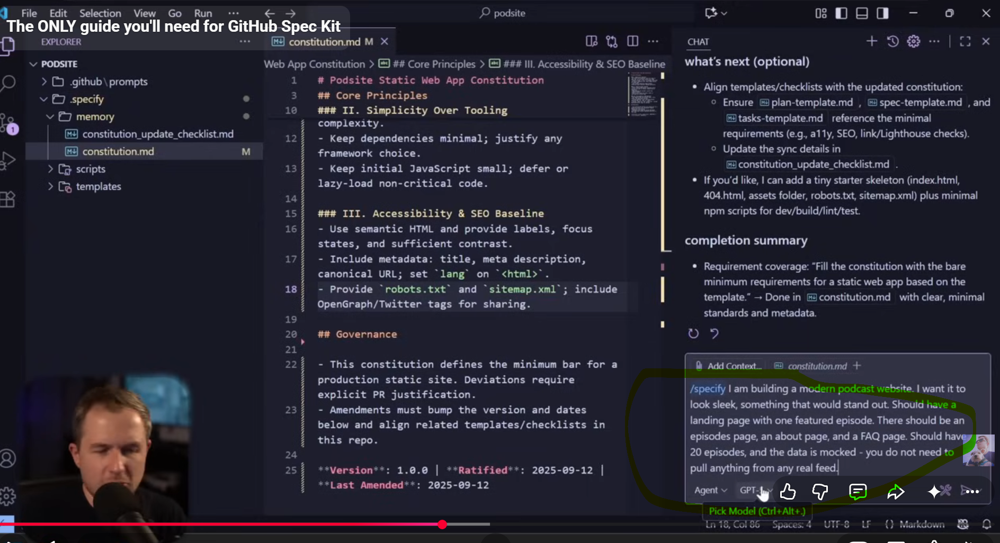
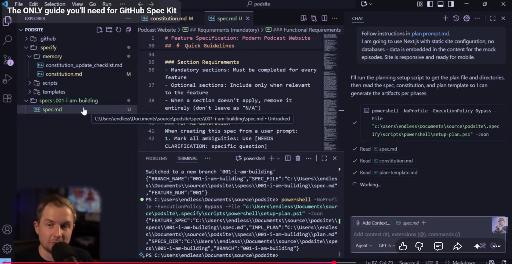
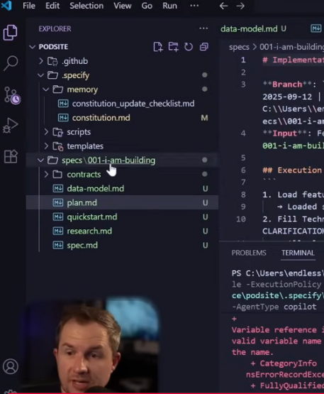
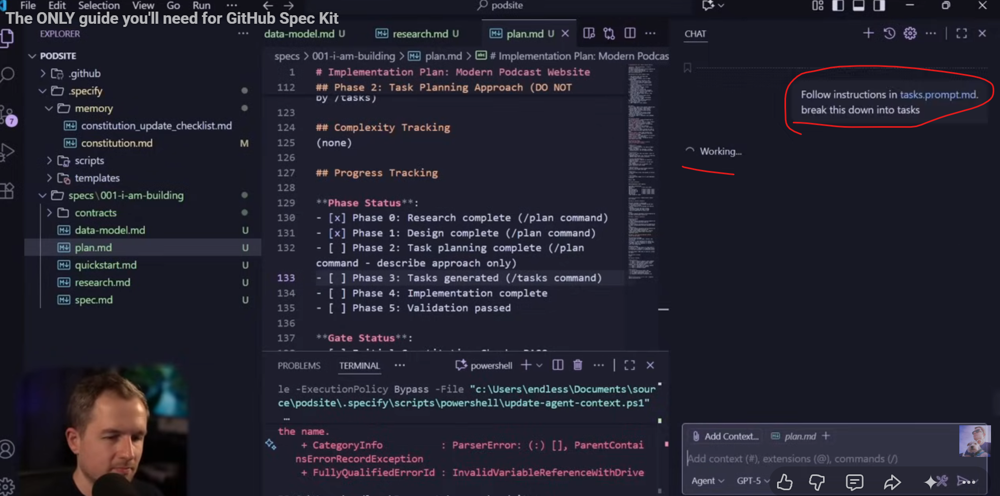
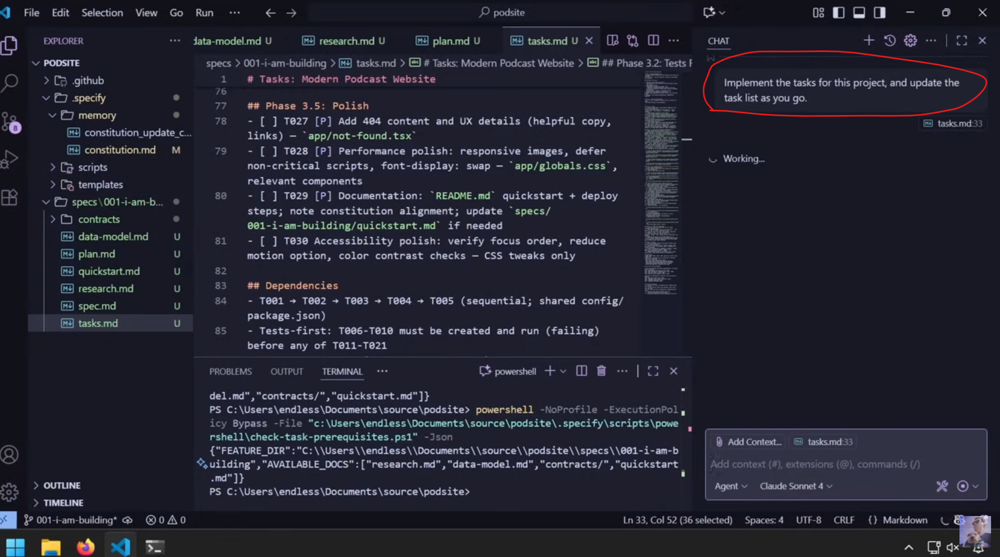

# Github Spec Kit

https://github.com/github/spec-kit (see this link for installation and others)

## # Github Spec Kit WIth New Project

https://www.youtube.com/watch?v=a9eR1xsfvHg&t=132s

Constitution file: Set of non-negotiable principles for your project, like i need next js for a specific version always., i always have to hve test.  

Then /specify: Specify the requirement   
  
Creates spec.md file   
Make sure to check Review and Acceptance checklist  in spec.md  

Then /plan: Specify technical requirement.   
  

See below imapge; except spec.md, other files are created through /plan  
  

Then /tasks: Break this down into tasks  
  
This creates tasks.md file  

Then:  
  
While implement i can change model to use better one    
Create actual artifacts like .js file etc   

Note: If i use Figma MCP, i can actually link to figma for wireframe.   

# Github Spec Kit

## # Github Spec Kit WIth Existing Project

https://www.youtube.com/watch?v=SGHIQTsPzuY

